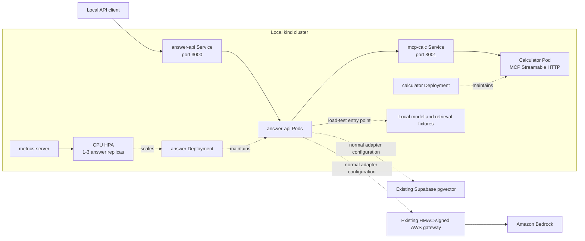
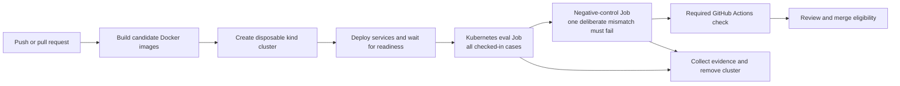

# Ask Pikalo Kubernetes architecture

This is an additive local deployment. The live Next.js application remains on
Vercel. Its existing in-process MCP path is retained; the Kubernetes variant
connects the same assistant and calculator logic through HTTP MCP.

The normal adapter configuration requires the existing gateway URL/signing key
and Supabase URL/publishable key. Cloud-backed requests require separate cost
approval. The load-test entry point hard-codes local fixture URLs; its numbers
do not include Bedrock inference or production database retrieval.

The answer path validates HTTP input, embeds and retrieves context, requests
calculator tools through a real MCP client, and applies the tool-required and
number-provenance guards before returning a cited answer. The benchmark fixture
model formats the actual Roth calculator output rather than inventing a number.

## Deployment acceptance

The gate requires 100% of calculator and provenance cases. The negative control
checks a real process exit of 1 and `Job Failed`; an image pull error or timeout
cannot satisfy it. Both successful and failed workflow paths attempt cleanup.
`main` requires the Kubernetes gate and the existing `check` and `infra` checks,
with up-to-date branches and administrator enforcement.

## Explain the design in an interview

- **Pod:** a replaceable running service instance; its address can change.
- **Deployment:** maintains desired replicas and replaces failed Pods.
- **Service:** stable DNS and routing to ready replicas; no client needs Pod IPs.
- **Probes:** startup allows initialization, readiness controls traffic, and
  liveness restarts an unresponsive process. Calculator failure affects answer
  readiness rather than forcing an answer-process restart.
- **ConfigMap/Secret:** separate ordinary configuration from credentials. Secret
  values are supplied outside Git; base64 is not encryption.
- **HPA:** scales answer replicas from measured CPU relative to requests. The
  60% target is 60m of a 100m CPU request, not 60% of the laptop CPU.
- **Job:** a run-to-completion workload used for an explicit, inspectable eval gate.

One kind control-plane node hosts everything, including the load generator.
The calculator and fixture backend each have one replica; either can become a
bottleneck. This project demonstrates local microservice deployment, correctness
gating and autoscaling behavior, not production Kubernetes availability or
multi-node capacity. An EKS deployment was intentionally omitted to keep this
work free and local.
